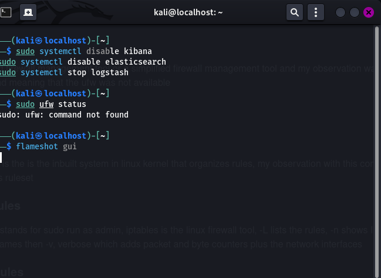
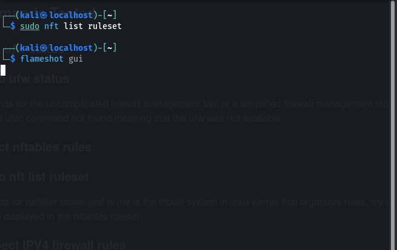
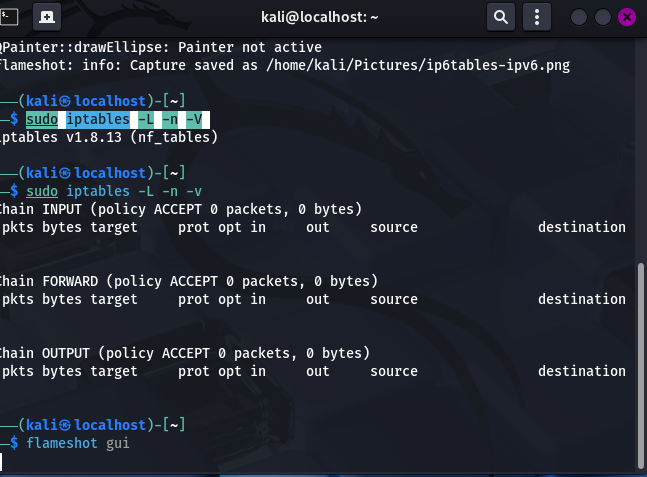
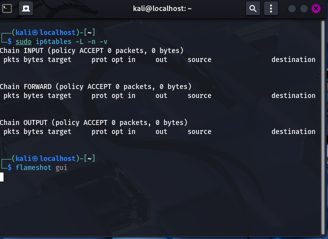

## The basics of firewall and my investigations
My objective is to understand the purpose of a firewall and investigate the tools and rules of the firewall that are available on my kali linux operating system. The tools to be used in this experiment are the kali linux terminal, UFW, nftables, iptables and ip6tables
## Commands Tested
### check ufw status
### 1 sudo ufw status
ufw stands for the uncomplicated firewall management tool or a simplified firewall management tool and my observation was that the terminal returned ufw: command not found meaning that the ufw was not available 

### inspect nftables rules
### 2 sudo nft list ruleset
nft stands for netfilter tables and is the is the inbuilt system in linux kernel that organizes rules, my observation with this command is that was no rules displayed in the nftables ruleset

### 3 Inspect IPV4 firewall rules
### sudo iptables -L -n -v
which stands for sudo run as admin, iptables is the linux firewall tool, -L lists the rules, -n shows IPS and ports as numbers instead of looking up names then -v also note that it should be small letter not big, verbose which adds packet and byte counters plus the network interfaces

### 4 Inspect IPV6 Firewall rules
### sudo ip6tables -L -n -v
this is for IPV6 networks and the observation was the same with iptables showing empty chains with a default of ACCEPT policy

## Lessons Learnt 
A firewall uses security tools that are configured to filter network traffic, ufw, nftables, and iptables are tools that are used to manage the linux firewall configuration, the IPV4 and IPV6 firewall rules need to be examined in seperate ways, An accept default policy allows packets unless another rule or a security mechanism blocks the traffic , an empty ruleset does not mean that every firewall is inactive
## My conclusion
I investigated the firewall configuration visible on my kali linux system without changing any rules, the displayed IPV4 and IPV6 chains had the ACCEPT default policies and no filtering rules, this practical exercise has improved my understanding of the linux firewall and the defensive network security and I did not change the default settings of the firewall during the learning as a safety procedure
## Practical Lab: Adding plus removing a temporary rule in the firewall
My objective is to add, inspect and remove a specific IPV4 firewall rule by using iptables on kali linux operating system
### Step 1: Inspect the baseline
The command being sudo iptables -s -OUTPUT: My observation is that the command showed -P OUTPUT ACCEPT which means that it is the default policy for the output chain that is the outgoing traffic
### Step 2: Adding a temporary rule 
The command being sudo iptables -A OUTPUT -d 192.0.2.1 -P ICMP --ICMP -type echo -request -j DROP : From my observation is that the rule was added to the output chain and a matched the outgoing icmp echo  request that was destined for 192.0.2.1 and also noting that the address belongs or is reserved for documetation purposes and examples and not a reality aspect
### Step 3: Inspect the rules
The command being sudo iptables -s -OUTPUT : My observation is that the output displayed the new DROP rule while still maintaining the default ACCEPT output policy 
### Step 4: Remove the temporary rule 
The command being sudo iptables -P OUTPUT -d 192.0.2.1 -p icmp --icmp type echo-request-j DROP
### Step 5: Verify the cleanup 
The command being sudo iptables -s OUTPUT the observation is that the output returned to -p OUTPUT ACCEPT while the temporary rule is not listed any longer
## Lessons learnt
I have learnt how to inspect or look at the firewall policies and the rules that are already occuring, How a network engeneer or a cyb
rersecurity specialist can add a narrowly or contained and stricted scopped of the firewall rule, How the DROP function or action can handle packets that are matching , How to remove a temporary rule that was by default in the firewall and the importance of checking a firewall configuration that was by default or originally before a test
## My Conclusion
What I have done is that i have successfully added, inspected, and removed an originally temporary rule in the firewall that was configured on kali linux and i verrified that the output chain returned to its original state that was dispalyed without changing the default policy the lab helped me to practise and learn basic linux firewall administration at the same time keeping the test limited and reversible

