## Packet analysis
This is the capturing and examining of network packets in order for someone to understand how the devices are communicating across a network, it helps us to troubleshoot network connectivity, identify suspicious traffic and understand the network protocols
## The tools used for packet analysis
### Wireshark
This is a graphical tool that is used to capture the packets in the network and can help us to identify the source and the destination of IP addresses, the communication protocals, the tcp and udp ports, the dns requests and responces and unusual traffic
### Tcpdump
This is a command line tool in that is used to capture and inspect the traffic in the network and is very useful when u are working with a linux terminal like kali linux or ubuntu and other linux machines
### Example: DNS traffic investigation 
Lets say my laptop is making some unexpected DNS requests then i can use a packet analysis tool such as tcpdump or wireshark to investigate which domains names are communicating on the network, which dns are being requested and the time the requests are occuring 
## Importance of packet analysis in security 
It helps us to troubleshoot network connectivity,identify suspicious traffic, and support incident investigation
## Lessons learnt
Packet analysis involves the examining of the network packets in order to understand how the devices are communicating across the network. Wireshark is a tool for packet analysis and it provides a graphical user interface for inspecting packets while tcpdump provide the command-line packet capture and inspection. Packet analysis is very usefull for troubleshooting networks and investigating security instances
## Practical lab 1: Capturing the DNS traffic with tcpdump
The objective is to capture and inspect DNS requests and responses on my kali linux machine machine. The tools to be used are kali linux operating system, tcpdump, and nslookup 
## Commands used
### checking the network interface
the command used to check the network interface are ip -br  address

ip - is the tool for managing network on linux, address means show the ip addresses and -br means breif in that the computer prints one short line per connection
the output is eth0 which is the interface for ethernet cable is down, wlan0 is the wifi and the lo is the loopback interface which is the computer talking to intself, 10.80.205.104/24  is the ipv4 address the first 3 numbers identify the network while the last one identifies the device that is what /24 means the interface to capture is wlan0 because it is the only one that is carrying traffic
### Capture the DNS traffic
the command being sudo tcpdump -i wlan0 -nn -vv port 53

this command records the DNS traffic going through my wifi, sudo means run it as the administrator, tcpdump is the too for packet analysis in cmd, -i wlan0 listens on the wifi interface, -nn this shows the raw IP and the numerical port numbers, -vv this one gives extra details, port 53 shows only the DNS traffic, because 53 is associated with DNS in the output the > is when u can tell queries from replies if the 53 port is on the right of the arrow it is ur request going to the server and if it is vice versa it is the server answering back to you
### Save a packet capture
sudo tcpdump -nn -vv -r /home/kali/dns-capture.pcap this command replays a packet that has been captured by the command sudo tcpdump -i wlan0 -nn port 53 -w dns-capture.pcap and also i noticed that u can filter while reading, for instance tcpdump -nn -r dns-capture.pcap port 53

### Generating a DNS lookup
the command being nslookup example.com asks a DNS server the ip address for example.com then prints the answer and also noted that the A and AAAA queries and replies  i captured are what nslookup triggers

## My observations
The wireless interface is wlan0 with IPV4 address 10.80.205.104/24 where the 3 numbers identify the network and the last number represents the device, the DNS resolver was 10.80.205.129 using udp port 53 and i observed a DNS A record querry for the example.com,the resolver returned an IPV4 address including 172.66.147.243 and also saw an AAAA record querry for an IPV6 address then i saved the packets captured to .pcap file and read the file with tcpdump
## Lessons that i learnt 
tcpdump captures live traffic of the network and also can read the save captured file for analysis or troubleshooting or investigations, i have also learnt how to identify the DNS queries, responces, ip source and destination, ports and A AND AAAA records
## Conclusion
Now i have understood how the DNS works in packets and how analysing the packets helps in trouble shooting networks and investigating security incidences
## Practical lab 2: Inspecting the DNS packets with wireshark
### My objective
The objective is tu use wireshark which is the graphical user interface tool for capturing packets and to inspect the DNS queries and responces that were captured with tcpdump in and saved in .pcap file, the tools i will be using are kali linux machine, wireshark 4.6.6 and a saved captured packet(dns.capture.pcap)
### The Procedure
Open the captured packets saved file in wireshark then enter the display filter at the top of the panel, click the DNS A query for the example.com, inspect the DNS querry name and the record type, examine the responces in the answeres section then lastly select an AAAA query to identify the IPV6 record type
## My Observations
The name of the dns querry was example.com, the A querry requested an IPV4 address that is associated with, the response from the DNS contained 2 IPV4 address that is 172.66.147.243 and 104.20.23.154, the AAAA query requested an IPV6 address and the dns filter helps to filter and show only the dns packets for analysis
## Lessons I have learnt
Wireshark is a graphical tool for packet analysis that inspects packets visually, with it i can see and find out DNS querries and responces and see their record types and addresses that are returned by the dns resolver. An A record is associated with IPV4 and AAAA record is associated with IPV6,and also a DNS response can have multiple addresses for one domain
## My Conclusion 
I have understood how the DNS resolution can look like in a packet capture and that tcpdump and wireshark can be used together to troubleshoot networks and investigate security incidents, a packet capture can contain very sensitive information so i will be hiding some information on my screenshots before sharing it publicly

## Practical lab 3: Observing the DNS traffic with tcpdump
### My Objective
My objective is to observe the DNS requests and responces on my kali linux machine and to understand the dns queries that are reapeting 
### The command used
The command used being sudo tcpdump -i wlan0 -nn -c 10 'port 53'which means the command is using tcpdump to capture and display the live network traffic this command captures the first 10 DNS packets that are moving across the wlan0 interface showing a raw and numerical format what each of the command does.
sudo this is the super user or admin privilleges meaning it is running the command at the highest level as it is required to interact directly with the network driver, tcpdump is the packet analysis tool for cmd, -i wlan0 this specifies the network interface to listen on wlan0, -i representing the interface, -nn disables the names and the service resolution, -c 10 sets the packet count limit ,instead of running continously and terminating with ctrl c u can set the packets limit to 10 to  cancel out the process of packet capture ,and the 'port 53' tells the tcpdump to only capture traffic where the source and destination is on port 53 which is the standard port that is used for the dns querries and responces,the nslookup example.co is what we are going to use as the dns server the command helps in network troubleshooting.

## My Observations
The observation from my terminal is that the machines ip address was 10.80.205.104, the dns resolver was 10.80.205.129, the dns traffic used port 53, An A query requested an IPV4 address for example.com, the response contained 104.20.23.154 and 172.66.147.243, repeated A queries appeared before a response, and the capture completed with 4 captured packets instead of the 10 maximum
## My lessons learnt 
The tcpdump can capture DNS traffic on a network interface that has been selected wether is etho for ethernet or wlan for wifi, dns queries that are repeated is an indication that the retries are caused by delays or responces missing but does not automatically indicate dangerous activity. An analyst should look at the packet timing,responses, destination names and the network sorrounding before he or she decides if the traffic is suspicious 
## My Conclusion
This exercise has helped me observe the DNS requests and the responces and practise to interprete packet captures , i have also learnt that the packet counts depends on the traffic that is observed and whether the capture is stopped or halted before the configured limit in the command
## Practical lab 4: Live DNS monitoring 
### My objective
The objective of this lab  is to monitor live DNS traffic on my kali linux machine and to see the queries for the different domain names the examples to be used are example.com and google.com
### Commands used
The command to be used are sudo tcpdump -i wlan0 -nn -l 'udp port 53' which listens for incoming and outgoing traffic of the dns and prints back the packets as they are arriving and may show less detail than verbose capture moreover as the tcpdump is listening we open another terminal to generate the DNS queries and the command to be used are nslookup example.com and nslookup google.com

### My observation 
The Capture ran on the wlan0 network interface, the filter selected the udp traffic using port 53, the DNS activity for example.com and google.com  were captured in my terminal
### Lessons Learnt
Tcpdump monitors DNS traffic as it is occuring by generating DNS requests, one can observe and see how the domain names  appear in packet captures. An unusual domain name and a repeated DNS request may be suspicious but neither all of them actually proved that a device has been compromised
### My Conclusion 
This lab has helped me to practise live DNS monitoring and to understand how defenders can investigate domain lookups, suspicious patterns in the captured packets  are clues that more evidence is required before one assumes malicious intent
## Practical lab 5: Inspecting Active Network connection
### My Objective
The objective is to identify active TCP connections, the application associated and the registered remote IP addresses of the organizations
### The commands used
The built in tool command in linux is ss. Open the terminal and run ss-tun the command will then display the TCP and UDP sockets to show the remote endpoints in kali the command used is ss-tnp which displays the tcp sockets numerically and show process information. The output of the command identified 3 tcp connections linked to firefox and all 3 remote endpoints used port 443 which is associated with HTTPS
### Whois command
This command is used to identify the IP address discovered during the display of servers in the network. The commands are (a) whois 140.82.112.26, (b) who is 34.107.243.93 and (c) who is 151.101.1.91. The findings I saw was that (a) is registered to github inc, (b) is registered to google LLC and also the whois noted that ggogle cloud customers use addresses in this allocation and the last one i checked was 151.101,1,91 that is registered to fastly
### Lessons Learnt
ss-tnp shows established TCP connections,remote and local ip addresses, port numbers and their processes. Whois identifies the organization that is associated with an IP address range, the port 443 indicates HTTPS traffic and the organizations such as google and fastly provides the infrastructure that is ued by other services
### My security takeaway 
One should relate the network connections with the dns info, app activity and many other evidences before he or she decides whether a connection is malicious

## Practical lab 6: DNS to Connection investigation
### My objective
I am going to observer the DNS resolution and compare it with the active TCP connections. The tools i will be using are nslookup which will be used to query DNS records, tcpdump that will be used to capture DNS packets, ss that will be used to inspect TCP connections and whois will be used to identify the organizations associated with IP address ranges
### The Commands used
The commands to be used are nslookup github.com, sudo tcpdump -i wlan0 -nn -l 'udp port 53', ss -tnp and whois 140.82.112.26
### My observations
The DNS resolver was 10.80.205.129 that was listening on the DNS port 53 and the DNS A querry for github.com returned 20.87.245.0, the AAAA query received a response with no IPV6 address records in its answer section, ss-tnp showed established firefox TCP connections to remote endpoints using 443 and whois associated the observed IP ranges with organizations including Github, Google and Fastly 
### Lessons learnt 
The dns translates domain names into IP adrresses, tcpdump captures the DNS queries and the responses and the ss displays active network connections. I have also realized that a result of the DNS and a connection that is active to an IP address are seperate observations and matching them requires careful correlation, A DNS lookup by itself does not proof that the hostname created a particular connection
### Security takeaway
Before assuming that a network activity is suspicious one should collect evidence, compare timestamps and endpoints and distinguish confirmed observations from assumptions before assuming

## Practical Lab 7: Inspecting the HTTPS and the TLS Certificates
The objective here is to look a servers TLS certificate and understand how it helps to secure HTTPS connections, the TLS is the security protocol for HTTPS connections
### The Command
The command to be used is openssl s_client -connect github.com:443 -servername github.com </dev/null. This command means as follows openssl s-client connects to the TLS server and displays the handshake and the certificate information
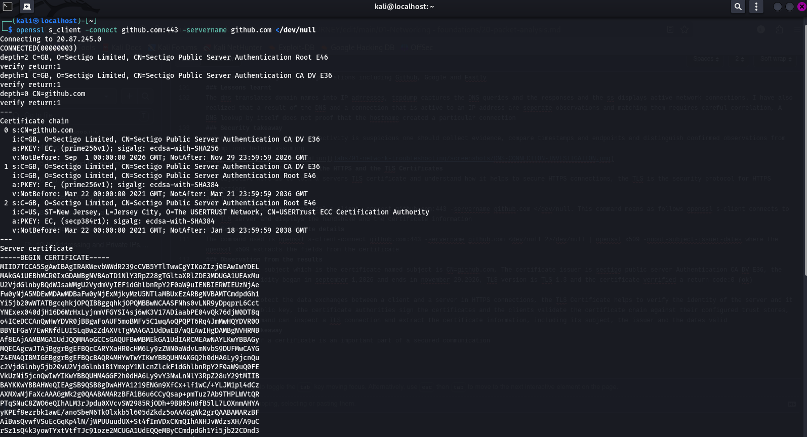
### Extracting the certificate details 
The command used is openssl s-client-connect github.com:443 -servername github.com <dev/null 2>/dev/null | openssl x509 -noout-subject-issuer-dates where the openssl x509 extracts the fields from the certificate

### Observation from the results
The certificate subject which is the certificate named subject is CN=github.com, The certificate issuer is sectigo public server Authentication CA DV E36, the certificate validity began in september 1,2026 and ends in november 29,2026, TLS version is TLS 1.3 and the certificate verrified a return code:0 (ok)
### Lessons Learnt 
TLS helps to protect the data exchanges between a client and a server in HTTPS connections, the TLS Certificate helps to verify the identity of the server and it contains its public key, the certificate authorities sign the certificates and the clients validate the certificate chain against their configured trust stores, the openssl command can inspect a TLS connection and extract the certificate information, including its subject, the issuer and the dates valid
### Security Takeaway
Verrification of a certificate is an important part of a secured communication 
## Practical Lab 8: Inspecting HTTPS traffic in wireshark
### The objective
My objective of this lab is to capture HTTPS traffic and inspect the TLS handshake information using wireshark tool 
### The Command to capture HTTPS traffic 
The command being sudo tcpdump -i wlan0 -nn -s 0 -w/tmp/https-lab.pcap 'tcp port 443' captures and saves the file to pcap; I opened github  in firefox while the capture was running and after stopping it the tcpdump reported 3898 captured packets 
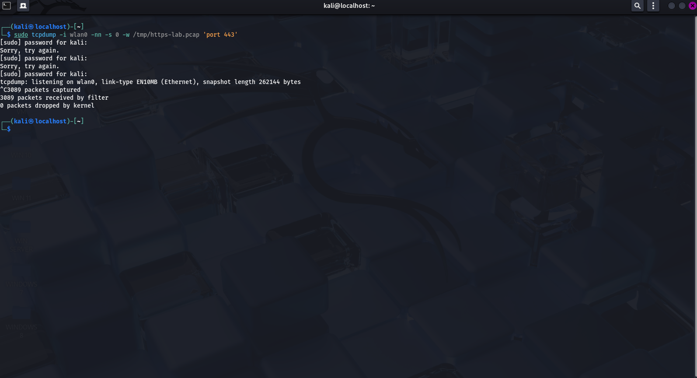
### Inspecting the capture of 3898 packets 
The command being wireshark /tmp/https-lab.pcap opens the captured file via wireshark then displays the filter by applying the command tls which filters the TLS packets, including client hello server hello, and the application data
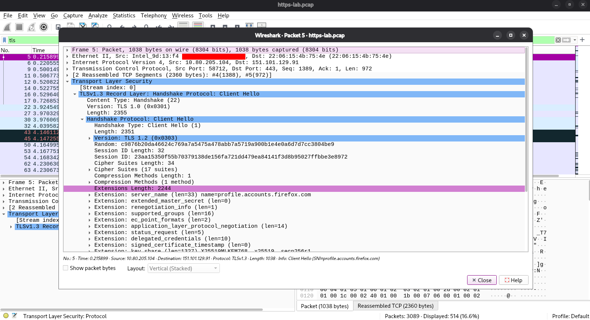
### 3 Inspecting a client hello packet 
When observing frame 9 i saw the source ip, destination ip, source port, destination port, the TLS handshake and the length of the handshake
## Lessons learnt 
The https uses port 443, the Tls uses handshake to establish security parameters before the application data that is protected is exchanged, A client hello begins the tls handshake, wireshark displays packet metadata and TLS handshake information even when the application data is encrypted, the version feilds in a TLS 1.3 client hello can contain legacy values for compatibility, A missing SNI field does not by itself prove that there is something wrong 
## My Conclusions
The HTTPs traffic was successfully captured and the TLS packets were inspected with tcpdump in wireshark, the exercise has helped me to understand how packet analysis can reveal connections
## Practical lab 9: Coorelating HTTPS connections with reverse DNS 
### Objecives
The purpose is to see active HTTPS connections and compare their remote IP addresses with the reverse DNS results:
### 1 The Command:
The command being ss-tnp inspects the active connections available then i observe 2 established TCP connections that were associated with firefox. ESR:- 10.80.205.104:43750-------34.107.245.93:443 and 10.80.205.104:58420--------140.82.113.26:443, both connections used the remote port 443 that is commonly associated with HTTPS
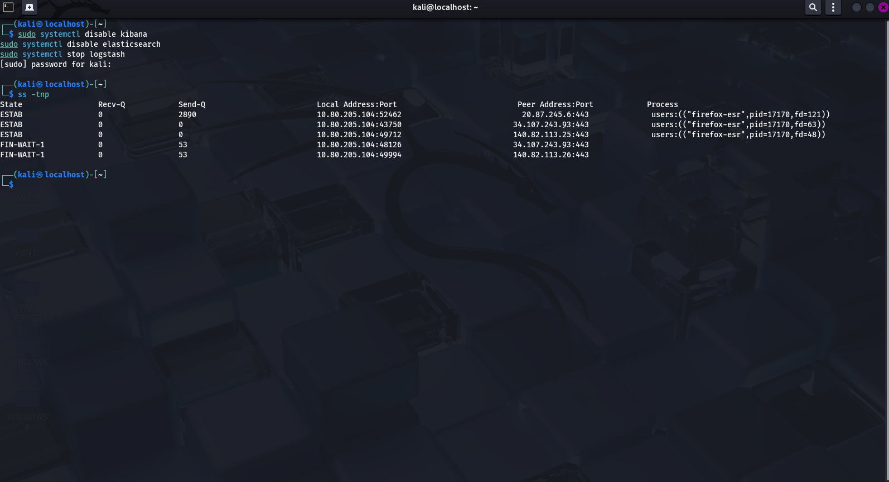
### 2 Investigating the 1st remote IP:
The command being nslookup 140.82.113.26 the DNS results came to lb-140.82.113.26.iad.github.com: the hostname is associated with the github infrastructure 
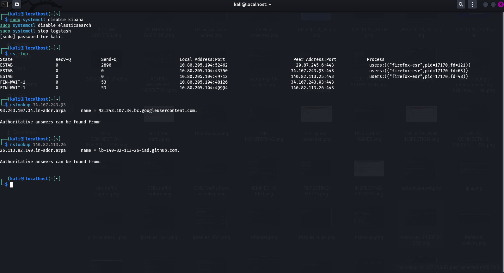
### 3 Investigating the 2nd remote IP 
The command being nslookup 34.107.243.93 the reverse dns result came to 93.243.107.34.bc.google user content.com the hostname is under googles googleusercontent.com domain indicates the google associated infrastructre

### Lessons Learnt
The ss command helps us to identify established TCP connections and their processes, reverse DNS is used in PTR records to associate the ip addresses with hostnames,A browser can maintain simultaneous connections to different remote services, reverse DNS provides the clues about an infrastructure: In network investigations they are stronger when multiple observations are coorelated, including the DNS records, TCP connections, the TLS information and the application context
### My Conclusion
I have used ss and nslookup to investigate the 2 active HTTPS connections from my kali and compared the remote IP addresses with their reverse dns names and i learnt how these observations helps in network investigation
## Practical lab 10: Capturing and Analysing the DNS traffic
### The Objective
The purpose is to capture DNS queries and responses using tcpdump and to  understand how a computer resolves domain names to IP addresses
### 1 DNS capture 
The command being sudo tcpdump -i wlan0 -nn -l 'udp port 53' uses wlan0 interface to monitor UDP traffic on port 53
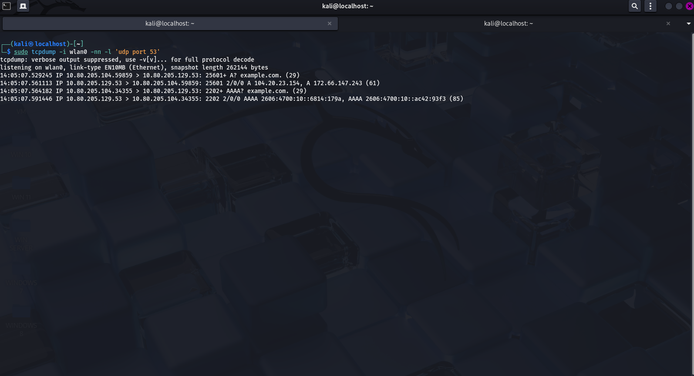
### 2 Generate DNS query 
The command being nslookup example.com the capture showed my laptop 10.80.205.104 sending DNS queries to the resolver 10.80.205.129 the command returned the following addresses
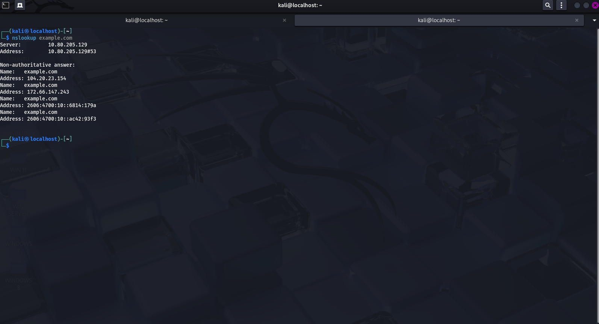
### IPV4 addresses
That is 172.66.147.243 and 104.20.23.154
### IPV6 addresses 
That is 2606:4700:10::ac42:9343 and 2606:4700:10::6814:179 a in which the results matched the A and AAAA records that were observed in the tcpdump capture
## Lessons Learnt 
tcpdump monitors DNS traffic on a network interface selected, DNS uses UDP port 53, A record contains IPV4 address, AAAA record contains IPV6 address, DNS query IDS helps one to associate responses with their requests
## Conclusion 
tcpdump and nslookup together enables one to observe DNS traffic and verify the return addresses, observed both A and AAAA queries and I have learnt how DNS help devices to obtain IP addresses for domain name
## Practical lab 11: DNS Caching and TTL
### Objective
The purpose is to understand why DNS answers can be reused and why they can change with time, TTL stands for time to live and in which in DNS it tells a resolver how long a DNS record may be cached before being refreshed 
### Step 1: Query the DNS records 
The command being dig example.com from my observations the TTL was 226 seconds, IPV4 addresses returned 104.20.23.154 and 172.66.147.243, the TTL of 226 seconds is the remaining cache lifetime reported by the resolver
### Step 2: Comparing the TTL values across 2 queries
When I ran dig example.com 2 times using the configured DNS resolver 10.80.205.129, the first query 2 A records with a TTL of 226 seconds. The 2nd query in 4 min and 23 seconds later returned the same 2 IPV4 addresses with a TTL of 244 seconds, the TTL increased instead of decreasing which indcates that the resolver refreshed the records
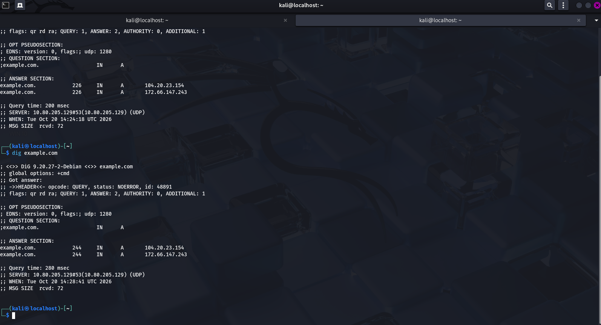
### My Observations 
When I queried the A records for example.com using the configured DNS resolver at 10.80.205.129 using the command dig@10.80.205.129 example.com A +noall +answer the queries returned the 2 IPV4 addresses that is 104.20.23.154 and 172.66.147.243, this command is a more controlled command to identify the TTL values. So the TTL values that I observed were 67,229,157,154 and 142, the TTL decreased from 157 to 154 to 142 seconds between 3 observations, however there was increase between earlier queries which may mean a different cache state or a refreshed DNS answer
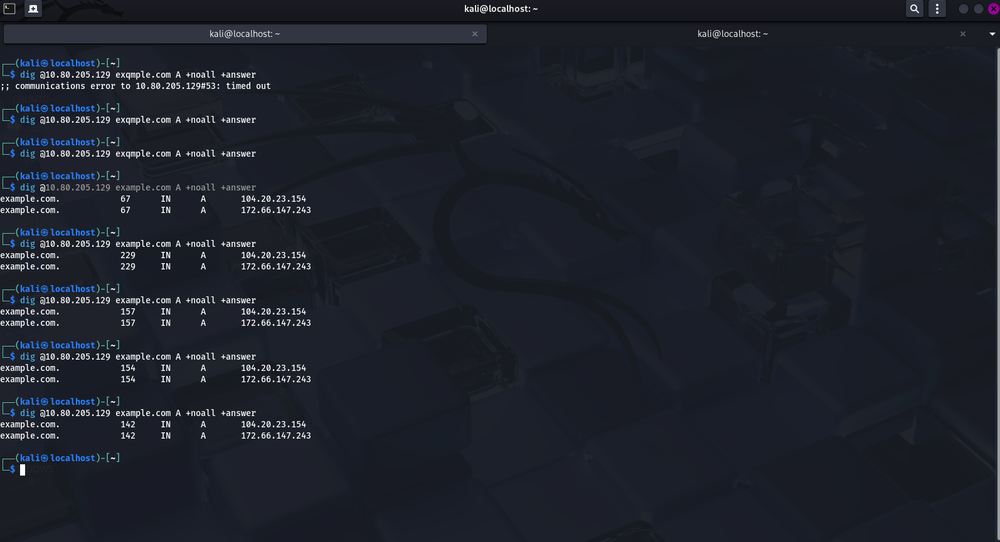
## Lessons Learned 
DNS TTL is expressed in seconds and indicated just how long a DNS record may remain cahed before it has to be refreshed, A remaining TTL decreases as time passes but then a later query can return a higher TTL if a fresh answer is obtained by the resolver. I have learned and understood that DNS answers can remain the same even though their TTL values can differ
## Practical lab 12: Investigating HTTPS connections and TCP states 
### My Objective
The purpose of this lab is to inspect live TCP connections on kali, identify connections used for HTTPS and observe the TCP  connection states
### Step 1: Inspecting the TCP connections
The command being ss -tnp: Initially the command showed no TCP  connections but after opening a webpage in firefox it displayed TCP connections that were associated with the firefox-esr process
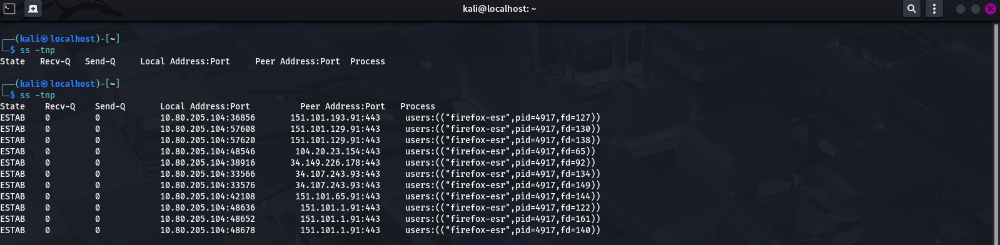
### Step 2: Identifying HTTPS-related connections 
The output produced ESTAB 0 0 10.80.205.104:39546 34.107.243.93:443 
### from Observations
10.80.205.104 is my laptops IP address, 33586 is the temporary TCP port, 34.107.243.93 is the remote IP address, 443 is the remote TCP port used for HTTPS connections, ESTAB means the TCP  connection is established and the receive and send ques were both 0
### Step 3: Filtering Connections by port destination
The command is ss -tnp '(dport = :443)' the output filtered displayed TCP connections whose port destination was 443(HTTPS) and the results included established connections which could chaange as firefox opens and closes connections
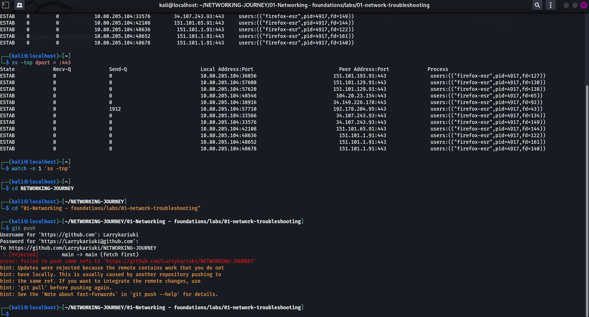
### Observing Live Connection states
The Command being watch -n 1 'ss -tnp' is used for live display which showed an established connection from 10.80.205.104:39546 to 34.107.243.93:443, in an earlier output i saw SYN-SENT and FIN-WAIT-1 states
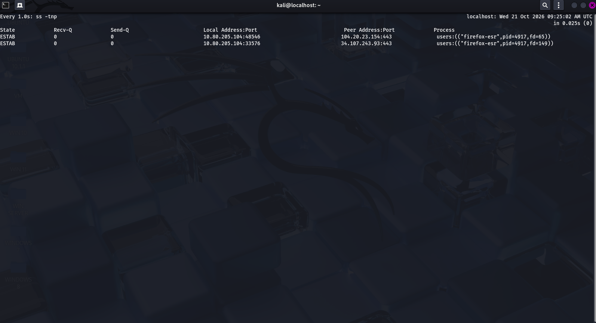
## Lessons learned
The ss command usually displays TCP connection information, ESTAB means that the TCP  connection is established, SYN-SENT means a connection attempt is waiting a response, FIN-WAIT-1 means the local endpoint started the TCP  clossing process, The ports 80 and 443 are for HTTP and HTTPS respectively, the watch command helps to observe how network connections can change over time in real time, if a TCP connection is established it does not mean necessarily that data is flowing continously 
## My conclusions
ss and watch can be used to inspect TCP connections that are created while browsing in firefox, I have identified HTTPS associated connections, observed different TCP states and i have confirmed that one connection remained established across repeated observations
## Practical lab 13: Capturing the HTTPS Traffic and observing the TCP handshake
### My Objective:
I want to capture the TCP traffic that is asociated with HTTPS using tcpdump tool and to identify the TCP 3-way handshake
### Step 1: Capture TCP traffic on port 443
Step 1 is to capture the TCP traffic on port 443, the command being sudo tcpdump -i wlan0 -nn -c20 'tcp port 443', the observation is that the capture showed packets travelling between my kali machine of IP address 10.80.205.104 and remote servers using TCP port 443, the output displayed TCP flags, sequence numbers, acknowledgement numbers,payload lengths
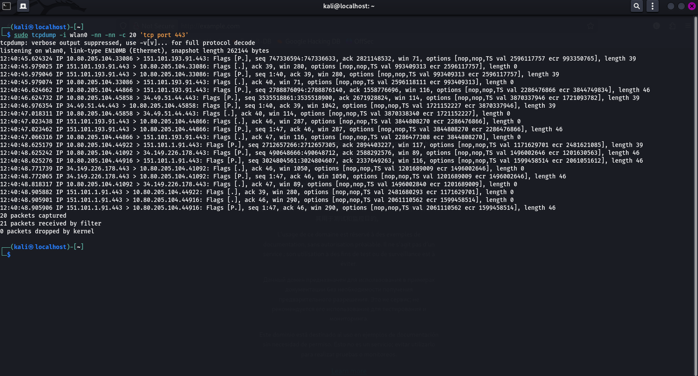
### Step 2: Filter for TCP C onnection setup packets
The command is sudo tcpdump -i Wlan0 -nn -c 30 tcp port 443 and (tcp[tcpflags] & (tcp-syn|tcp-ack) !=0) from my observation is that the first attempt produced a filter syntax error. After I corrected my command, the tcpdump tool successfully captured 30 packets. The output included packets that are associated with the connection between 10.80.205.104 and 151.101.193.91
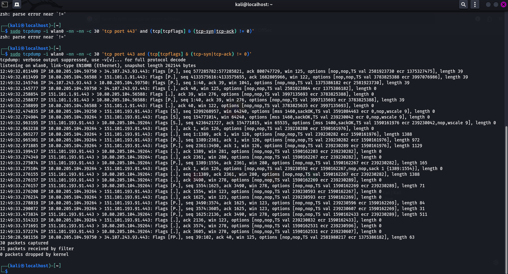
### Step 3: Identify the TCP 3-WAY handshake
The capture showed these following sequence for the connection using local port 39264 and remote port 443, (1) SYN - Means that my laptop requested a TCP connection, SYN-ACK - Means that the remote endpoint responded with SYN and ACK flags and ACK - Which means that my laptop acknowledged the responce and completed the 3 way handshake 
### Step 4: Interpreting the other packet details 
Flag - This indicates PSH and ACK flags are set, Length0 - Means the packet contains 0 TCP payload bytes, seq and ack are TCP sequence and acknowledgement numbers, 443 is the TCP port used for  HTTPs, the final capture reported 30 packets captured and o packets dropped by the kernel
## Lessons Learnt 
Tcpdump Captures  real TCP traffic and display the information that is needed to investigate network connections, A TCP connection known as a 3-WAY handshake begins with SYN, SYN-ACK and ACK packets , once a TCP is established the endpoints can then proceed with TLS negotiation and encrypted HTTPS connection, I have also learnt that a packet filter must use correct syntax and that TCP flags help to distinguish connection setup packets from other traffic 
## My Conclusion 
The TCP  traffic was successfully captured on port 443 and I identified the packets that were corresponding to the 3-way handshake, this lab exercise has helped me to connect the TCP states that I have observed with ss to the actual packets visible in tcpdump. The capture showed TCP connection activity, but did not reveal the contents of encrypted HTTPS application data
## Practical lab 14: Observing both DNS and HTTPS together 
### My Objective 
The purpose of the lab is to observe the DNS queries and responses and to inspect TCP connections that are associated with HTTPS
## Step 1 : Capturing DNS traffic:
The command being sudo tcpdump -i wlan0 -nn -c 10 ;port 53', from my capture I saw that DNS queries from my kali linux machine of IP address 10.155.169.104 to the resolver at 10.155.169.127:53. The queries included A and AAAA records for mozilla related domain names, and the responses included IPV4 addresses, IPV6 addresses and CNAME records
## Step 2: Inspecting HTTPS-related connections
The command being ss -tnp dport:443, the output showed an estaablished connection Estab 0 . 0 10.155.169.104:45470, 34.107.243.93:443, the connection was associated with firefox ESR. The remote port is 443 used for HTTPS 
## Step 3: Capturing the DNS and TCP Observations
The DNS captured showed the answers for many mozilla-related domain names, while the tcp connectionshowed was to 34.107.243.93.443. The remote IP address did not match the IPV4 address returned for mozilla .map.fasltly.net in the captured DNS response because the capture contained queries for multiple names and DNS answers and TCP connections were observed seperately, I failed to establish which DNS response led to this particular connection
## Lessons Learnt
The DNS helps applications to obtain addressing information while TCP establishes connections to remote endpoints. HTTPS uses TCP port 443, followed by TLS negotiation when using TCP based HTTPS. Observing DNS and TCP traffic seperately helps one to investigate network activity, but correlating a particular DNS answer with a connection requires matching the relevant domain, IP address, timing and connection evidence 
## Conclusion
I have captured DNS traffic and have inspected and established HTTPS associated TCP connection on kali linux. The lab exercise has helped me to understand how name resolution and net connections relate, while recognizing the limits of evidence gathered in seperate screenshots

