## Packet analysis
This is the capturing and examining of network packets in order for someone to understand how the devices are communicating across a network, it helps us to troubleshoot network connectivity, identify suspicious traffic and understand the network protocols
## The tools used for packet analysis
### Wireshark
This is a graphical tool that is used to capture the packets in the network and can help us to identify the source and the destination of IP addresses, the communication protocals, the tcp and udp ports, the dns requests and responces and unusual traffic
### Tcpdump
This is a commandl-ine tool in that is used to capture and inspect the traffic in the network and is very usefull when u are working with a linux terminal like kali linux or ubuntu and other linux machines
### Example: DNS traffic investigation 
Lets say my laptop is making some unexpected DNS requests then i can use a packet analysis tool such as tcpdump or wireshark to investigate which domains names are communicating on the network, which dns are being requested and the time the requests are occuring 
## Importance of packet analysis in security 
It helps us to troubleshoot network connectivity,identify suspicious traffic, and support incident investigation
## Lessons learnt
Packet analysis involves the examining of the network packets in order to understand how the devices are communicating across the network. Wireshark is a tool for packet analysis and it provides a graphical user interface for inspecting packets while tcpdump provide the command-line packet capture and inspection. Packet analysis is very usefull for troubleshooting networks and investigating security instances
## Practical lab 1: Capturing the DNS traffic with tcpdump
The objective is to capture and inspect DNS requests and responses on my kali linux machine machine. The tools to be used are kali linux operating system, tcpdump, and nslookup 
## Commands used
### checking the network interface
the command used to check the network interface are ip -br  address
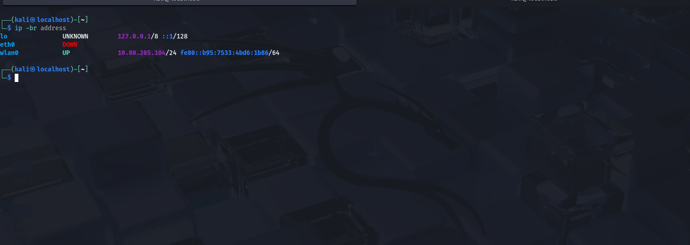
ip - is the tool for managing network on linux, address means show the ip addresses and -br means breif in that the computer prints one short line per connection
the output is eth0 which is the interface for ethernet cable is down, wlan0 is the wifi and the lo is the loopback interface which is the computer talking to intself, 10.80.205.104/24  is the ipv4 address the first 3 numbers identify the network while the last one identifies the device that is what /24 means the interface to capture is wlan0 because it is the only one that is carrying traffic
### Capture the DNS traffic
the command being sudo tcpdump -i wlan0 -nn -vv port 53
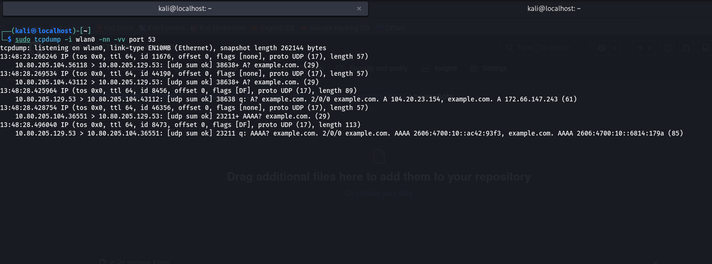
this command records the DNS traffic going through my wifi, sudo means run it as the administrator, tcpdump is the too for packet analysis in cmd, -i wlan0 listens on the wifi interface, -nn this shows the raw IP and the numerical port numbers, -vv this one gives extra details, port 53 shows only the DNS traffic, because 53 is associated with DNS in the output the > is when u can tell queries from replies if the 53 port is on the right of the arrow it is ur request going to the server and if it is vice versa it is the server answering back to you
### Save a packet capture
sudo tcpdump -nn -vv -r /home/kali/dns-capture.pcap this command replays a packet that has been captured by the command sudo tcpdump -i wlan0 -nn port 53 -w dns-capture.pcap and also i noticed that u can filter while reading, for instance tcpdump -nn -r dns-capture.pcap port 53
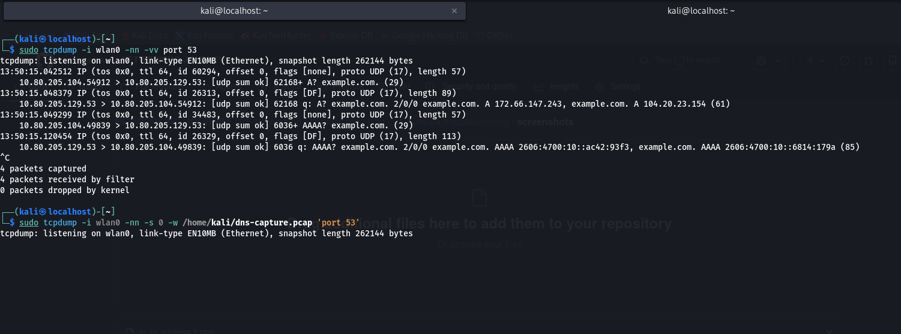
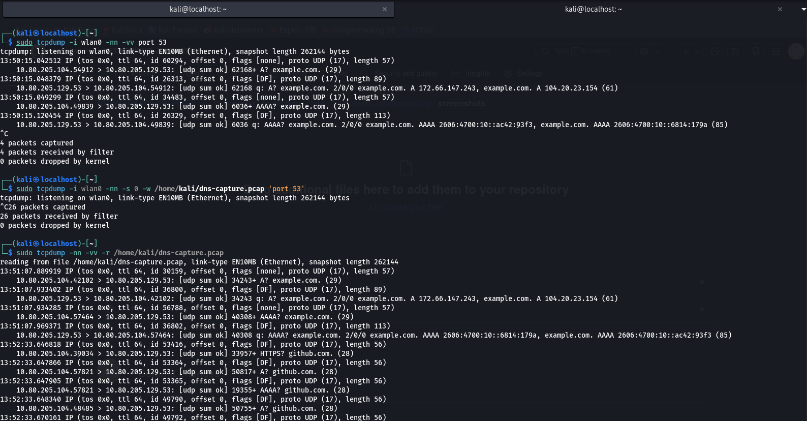
### Generating a DNS lookup
the command being nslookup example.com asks a DNS server the ip address for example.com then prints the answer and also noted that the A and AAAA queries and replies  i captured are what nslookup triggers
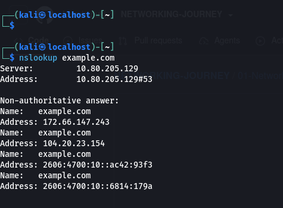
## My observations
The wireless interface is wlan0 with IPV4 address 10.80.205.104/24 where the 3 numbers identify the network and the last number represents the device, the DNS resolver was 10.80.205.129 using udp port 53 and i observed a DNS A record querry for the example.com,the resolver returned an IPV4 address including 172.66.147.243 and also saw an AAAA record querry for an IPV6 address then i saved the packets captured to .pcap file and read the file with tcpdump
## Lessons that i learnt 
tcpdump captures live traffic of the network and also can read the save captured file for analysis or troubleshooting or investigations, i have also learnt how to identify the DNS queries, responces, ip source and destination, ports and A AND AAAA records
## Conclusion
Now i have understood how the DNS works in packets and how analysing the packets helps in trouble shooting networks and investigating security incidences
## Practical lab 2: Inspecting the DNS packets with wireshark
### My objective
The objective is tu use wireshark which is the graphical user interface tool for capturing packets and to inspect the DNS queries and responces that were captured with tcpdump in and saved in .pcap file, the tools i will be using are kali linux machine, wireshark 4.6.6 and a saved captured packet(dns.capture.pcap)
### The Procedure
Open the captured packets saved file in wireshark then enter the display filter at the top of the panel, click the DNS A query for the example.com, inspect the DNS querry name and the record type, examine the responces in the answeres section then lastly select an AAAA query to identify the IPV6 record type
## My Observations
The name of the dns querry was example.com, the A querry requested an IPV4 address that is associated with, the response from the DNS contained 2 IPV4 address that is 172.66.147.243 and 104.20.23.154, the AAAA query requested an IPV6 address and the dns filter helps to filter and show only the dns packets for analysis
## Lessons I have learnt
Wireshark is a graphical tool for packet analysis that inspects packets visually, with it i can see and find out DNS querries and responces and see their record types and addresses that are returned by the dns resolver. An A record is associated with IPV4 and AAAA record is associated with IPV6,and also a DNS response can have multiple addresses for one domain
## My Conclusion 
I have understood how the DNS resolution can look like in a packet capture and that tcpdump and wireshark can be used together to troubleshoot networks and investigate security incidents, a packet capture can contain very sensitive information so i will be hiding some information on my screenshots before sharing it publicly
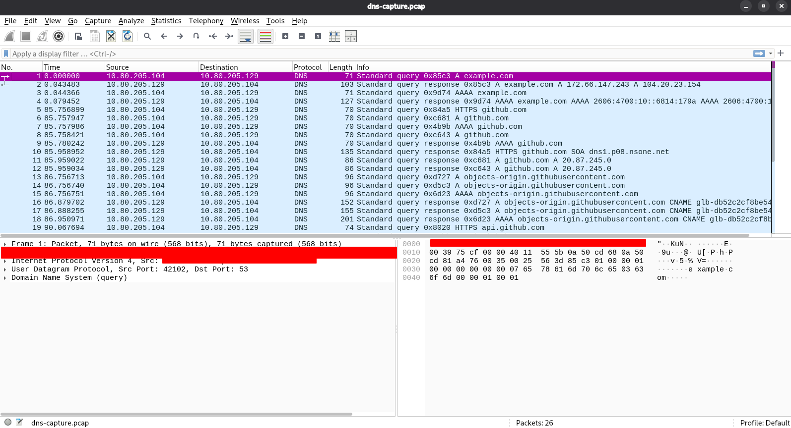
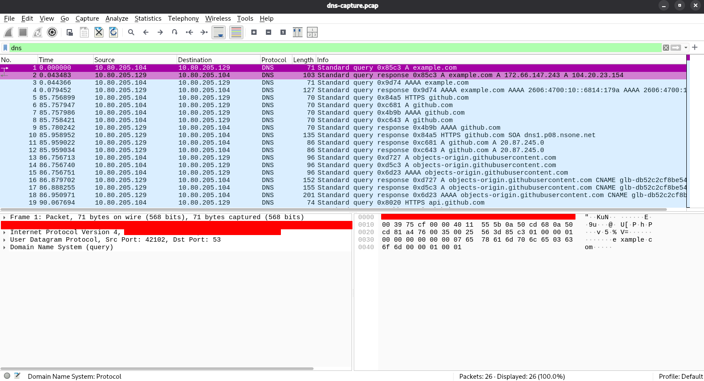
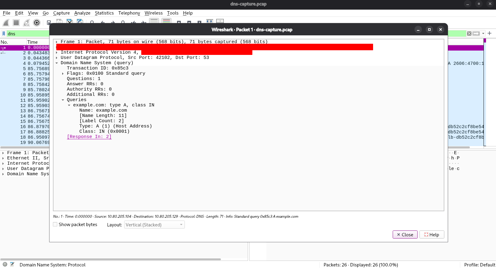
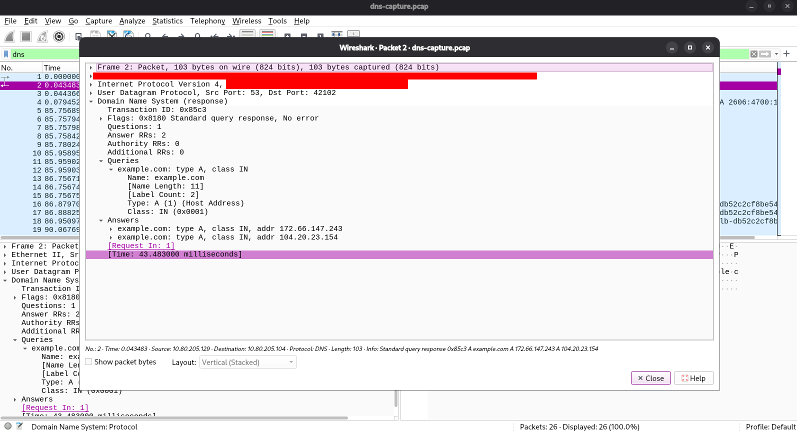
## Practical lab 3: Observing the DNS traffic with tcpdump
### My Objective
My objective is to observe the DNS requests and responces on my kali linux machine and to understand the dns queries that are reapeting 
### The command used
The command used being sudo tcpdump -i wlan0 -nn -c 10 'port 53'which means the command is using tcpdump to capture and display the live network traffic this command captures the first 10 DNS packets that are moving across the wlan0 interface showing a raw and numerical format what each of the command does.
sudo this is the super user or admin privilleges meaning it is running the command at the highest level as it is required to interact directly with the network driver, tcpdump is the packet analysis tool for cmd, -i wlan0 this specifies the network interface to listen on wlan0, -i representing the interface, -nn disables the names and the service resolution, -c 10 sets the packet count limit ,instead of running continously and terminating with ctrl c u can set the packets limit to 10 to  cancel out the process of packet capture ,and the 'port 53' tells the tcpdump to only capture traffic where the source and destination is on port 53 which is the standard port that is used for the dns querries and responces,the nslookup example.co is what we are going to use as the dns server the command helps in network troubleshooting.
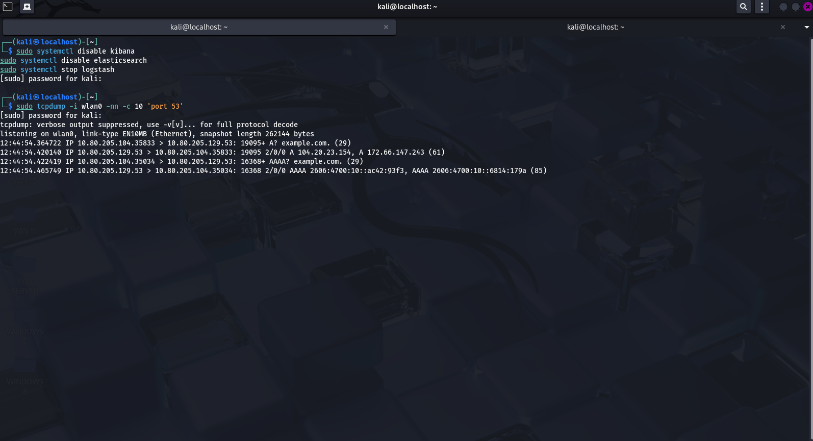
## My Observations
The observation from my terminal is that the machines ip address was 10.80.205.104, the dns resolver was 10.80.205.129, the dns traffic used port 53, An A query requested an IPV4 address for example.com, the response contained 104.20.23.154 and 172.66.147.243, repeated A queries appeared before a response, and the capture completed with 4 captured packets instead of the 10 maximum
## My lessons learnt 
The tcpdump can capture DNS traffic on a network interface that has been selected wether is etho for ethernet or wlan for wifi, dns queries that are repeated is an indication that the retries are caused by delays or responces missing but does not automatically indicate dangerous activity. An analyst should look at the packet timing,responses, destination names and the network sorrounding before he or she decides if the traffic is suspicious 
## My Conclusion
This exercise has helped me observe the DNS requests and the responces and practise to interprete packet captures , i have also learnt that the packet counts depends on the traffic that is observed and whether the capture is stopped or halted before the configured limit in the command
## Practical lab 4: Live DNS monitoring 
### My objective
The objective of this lab  is to monitor live DNS traffic on my kali linux machine and to see the queries for the different domain names the examples to be used are example.com and google.com
### Commands used
The command to be used are sudo tcpdump -i wlan0 -nn -l 'udp port 53' which listens for incoming and outgoing traffic of the dns and prints back the packets as they are arriving and may show less detail than verbose capture moreover as the tcpdump is listening we open another terminal to generate the DNS queries and the command to be used are nslookup example.com and nslookup google.com
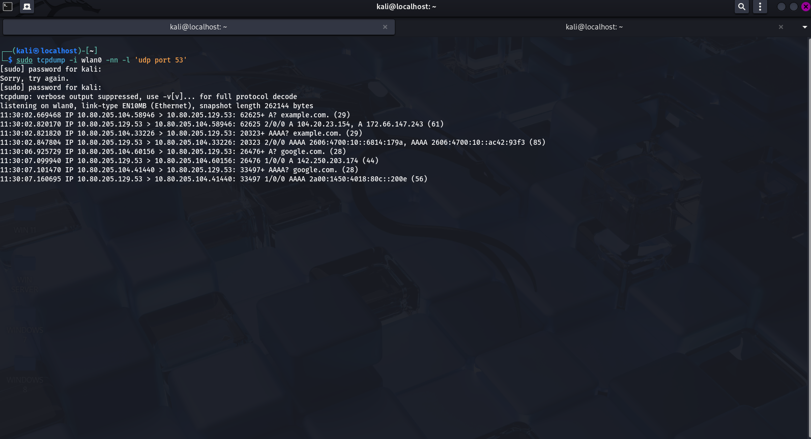
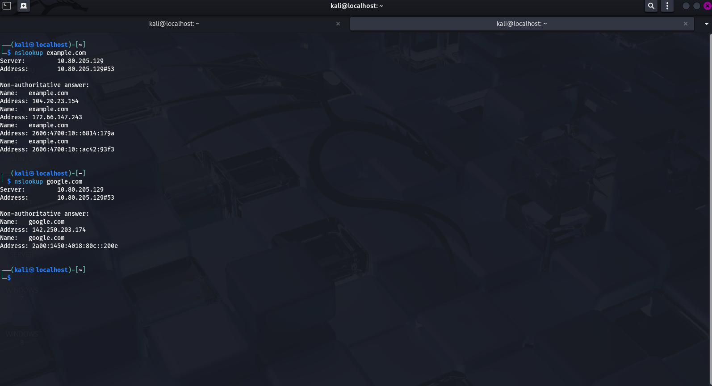
### My observation 
The Capture ran on the wlan0 network interface, the filter selected the udp traffic using port 53, the DNS activity for example.com and google.com  were captured in my terminal
### Lessons Learnt
Tcpdump monitors DNS traffic as it is occuring by generating DNS requests, one can observe and see how the domain names  appear in packet captures. An unusual domain name and a repeated DNS request may be suspicious but neither all of them actually proved that a device has been compromised
### My Conclusion 
This lab has helped me to practise live DNS monitoring and to understand how defenders can investigate domain lookups, suspicious patterns in the captured packets  are clues that more evidence is required before one assumes malicious intent
## Practical lab 5: Inspecting Active Network connection
### My Objective
The objective is to identify active TCP connections, the application associated and the registered remote IP addresses of the organizations
### The commands used
The built in tool command in linux is ss. Open the terminal and run ss-tun the command will then display the TCP and UDP sockets to show the remote endpoints in kali the command used is ss-tnp which displays the tcp sockets numerically and show process information. The output of the command identified 3 tcp connections linked to firefox and all 3 remote endpoints used port 443 which is associated with HTTPS
### Whois command
This command is used to identify the IP address discovered during the display of servers in the network. The commands are (a) whois 140.82.112.26, (b) who is 34.107.243.93 and (c) who is 151.101.1.91. The findings I saw was that (a) is registered to github inc, (b) is registered to google LLC and also the whois noted that ggogle cloud customers use addresses in this allocation and the last one i checked was 151.101,1,91 that is registered to fastly
### Lessons Learnt
ss-tnp shows established TCP connections,remote and local ip addresses, port numbers and their processes. Whois identifies the organization that is associated with an IP address range, the port 443 indicates HTTPS traffic and the organizations such as google and fastly provides the infrastructure that is ued by other services
### My security takeaway 
One should relate the network connections with the dns info, app activity and many other evidences before he or she decides whether a connection is malicious
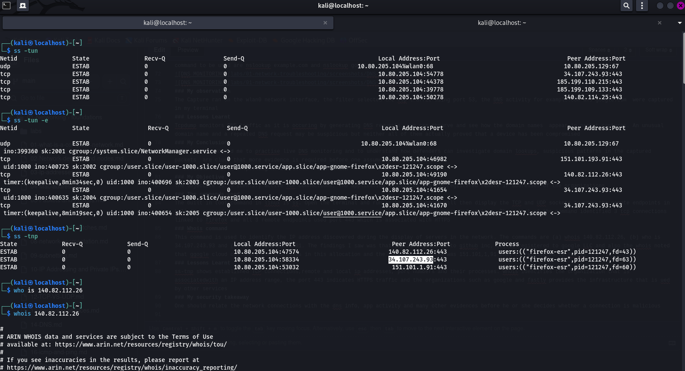
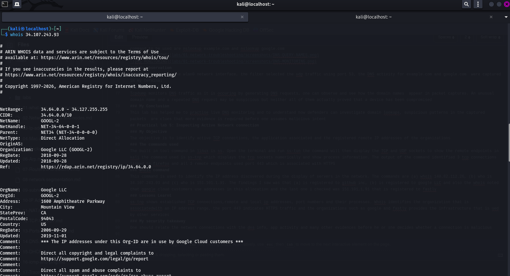
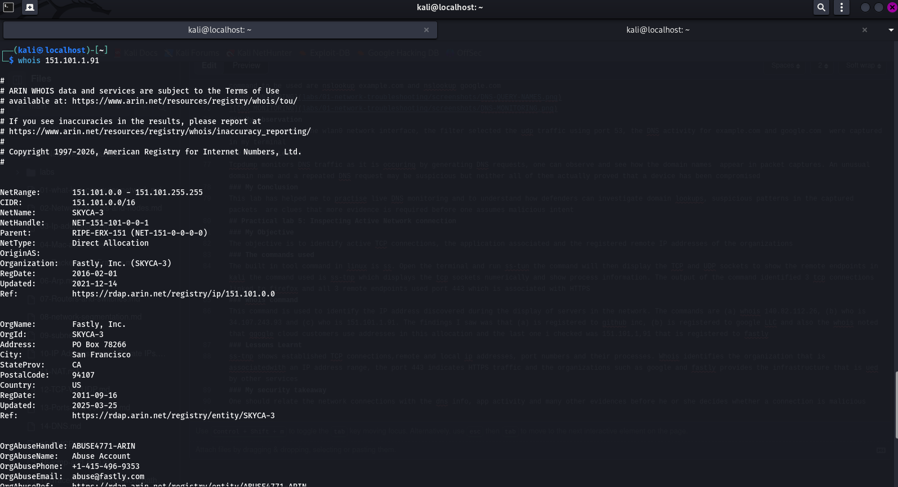
## Practical lab 6: DNS to Connection investigation
### My objective
I am going to observer the DNS resolution and compare it with the active TCP connections. The tools i will be using are nslookup which will be used to query DNS records, tcpdump that will be used to capture DNS packets, ss that will be used to inspect TCP connections and whois will be used to identify the organizations associated with IP address ranges
### The Commands used
The commands to be used are nslookup github.com, sudo tcpdump -i wlan0 -nn -l 'udp port 53', ss -tnp and whois 140.82.112.26
### My observations
The DNS resolver was 10.80.205.129 that was listening on the DNS port 53 and the DNS A querry for github.com returned 20.87.245.0, the AAAA query received a response with no IPV6 address records in its answer section, ss-tnp showed established firefox TCP connections to remote endpoints using 443 and whois associated the observed IP ranges with organizations including Github, Google and Fastly 
### Lessons learnt 
The dns translates domain names into IP adrresses, tcpdump captures the DNS queries and the responses and the ss displays active network connections. I have also realized that a result of the DNS and a connection that is active to an IP address are seperate observations and matching them requires careful correlation, A DNS lookup by itself does not proof that the hostname created a particular connection
### Security takeaway
Before assuming that a network activity is suspicious one should collect evidence, compare timestamps and endpoints and distinguish confirmed observations from assumptions before assuming
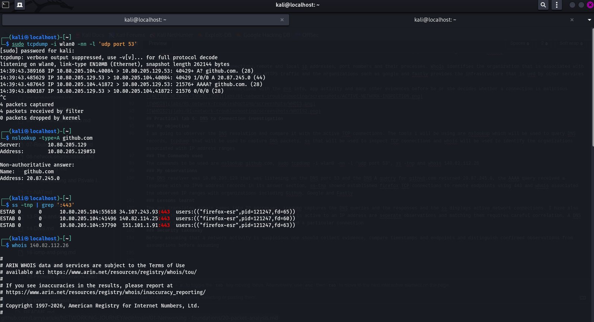
## Practical Lab 7: Inspecting the HTTPS and the TLS Certificates
The objective here is to look a servers TLS certificate and understand how it helps to secure HTTPS connections, the TLS is the security protocol for HTTPS connections
### The Command
The command to be used is openssl s_client -connect github.com:443 -servername github.com </dev/null. This command means as follows openssl s-client connects to the TLS server and displays the handshake and the certificate information

### Extracting the certificate details 
The command used is openssl s-client-connect github.com:443 -servername github.com <dev/null 2>/dev/null | openssl x509 -noout-subject-issuer-dates where the openssl x509 extracts the fields from the certificate
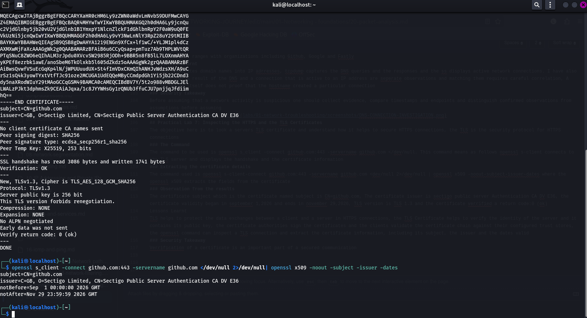
### Observation from the results
The certificate subject which is the certificate named subject is CN=github.com, The certificate issuer is sectigo public server Authentication CA DV E36, the certificate validity began in september 1,2026 and ends in november 29,2026, TLS version is TLS 1.3 and the certificate verrified a return code:0 (ok)
Lessons Learnt 
TLS helps to protect the data exchanges between a client and a server in HTTPS connections, the TLS Certificate helps to verify the identity of the server and it contains its public key, the certificate authorities sign the certificates and the clients validate the certificate chain against their configured trust stores, the openssl command can inspect a TLS connection and extract the certificate information, including its subject, the issuer and the dates valid
### Security Takeaway
Verrification of a certificate is an important part of a secured communication 

