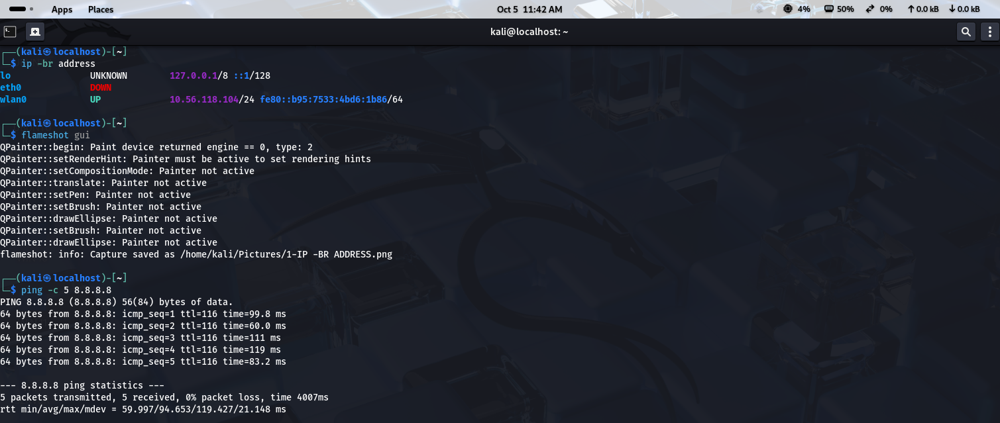
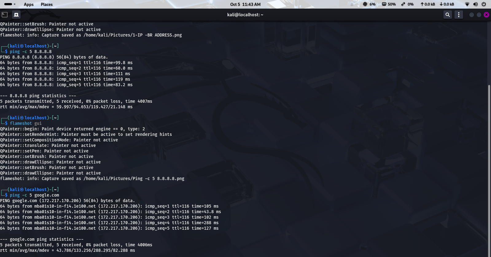

## Objective 
My objective of the lab is that to practise the basics of network troubleshooting using kali linux, I need to understand how i can test connectivity, check the IP configuration, investigate the DNS resolution and inspect the route to a destination
## Lab Environment 
My operatinng system is kali linux and my internet connection is mobile-hotspot the tools that I will use are IP, Ping and traceroute and the test destination will be google public DNS server 8.8.8.8
## Test 1 Inspecting the network interfaces
Inspect the network the network interfaces and the command: IP-br address, this command displays network interfaces and their  IP  address assigned in a format, so what i will be looking for is which network interfaces are available, which network interface is active and if the interface has an IP address, my observation as per the screenshot shows as follows
## Test 2 Test IP connectivity 
The command being ping -c 5 8.8.8.8 the purpose is that this sends 5 icmp echo requests to 8.8.8.8 and it checks the replies arrival, what iam looking for is whether the replies are received, the round trip  time in ms and the packet loss percentage. My observation from the from the screenshot i sent 5 ICMP Echo requests to 8.8.8.8 and all received replies resulting in 0 percent packet loss and the average round trip was 94.7ms
### Screenshot

## Test 3 Test the DNS resolution 
The command is: ping -c 5 google.com the purpose is to test whether kali can resolve the domain name and whether the destination responds to a ping request: I  will be  looking whether the destination responds to an IP address, whether the domain resolves to an IP address whether the replies arrive or whether there is an occurrence of packet loss. My observation is that when i used the ping -c-5-google.com,the domain resolved successfully to 172.217.170.206 and then all the 5 ICMP echo requests received replies and resulting in a 0% packet loss and the average round trip time was 133.3ms

## Test 4 Trace the Network path:
the commands being 8.8.8.8, the trace route being google .com, the purpose of traceroute path is that it helps to reveal the network hops that respond to the probes that are travelling to the destinations. The earlier results showed that private IP addresses at many hops, a hop associated with an airtel kenya hstname, and a successful response from 8.8.8.8 while some intermediate hops displays *****on my observation from the screenshot is that when i ran the traceroute 8.8.8.8  from my kali terminal while i was conected to my phones hotspot the destination responded at hop 9 , sevral intermediate hops dispalyed asterix that which showed that there was no response that arrived before timeout but that didnt prevent the destination from responding, what the trace showed is that the private ip address at severall hops and a response hop that was associated with airtel kenya host name and the results helped me to learn and understand how traffic travels through provider networks or isp before reaching the public destination 

## My Analysis 
Through my experiments i have learned how to inspect the interface of the network, test the connectivity of the network  using ping command, trace the path taken by the packets towards a destination and verify the DNS resolution. What was evident in my tests was that the kali linux linux operating system had an active network interface and an IP address assigned, the replies were received from 8.8.8.8 and with a 0 percent packet loss, the google.com resolved to an IP address, and the ping command was successful. The traceroute path showed multiple hops within the network before reaching the destination which was reachable but the intermediate hops were not responding. The lab has helped me to understand and connect the networking theory wuith the practical troubleshooting on a kali linux operating system 
## 
## What I have Learnt 
Network troubleshooting will work best when testing one layer or possibility at a time e.g checking the IP configuration testing the IP connectivity, checking DNS resolution and tracing the network path,  they provide different pieces of evidence and one should interpret or read the results carefully rather than assume that an attempt failed proved the network has issues, by testing the basics of network connection and seen how traffic travels from my device to a public internet destination, the skills learnt form the foundation for the learning of network engeneering and cybersecurity

